# BahaBantay 🌊

**Turns messy Filipino flood reports into a clear action for residents and a ranked, verified queue for barangay responders.**
Built for the Meta Global AI Developer Hackathon (Oct 26 – Nov 4, 2026), using **Meta SAM 3.1** and **Muse Spark**.

Live demo: https://bahabantay-466317436519.asia-southeast1.run.app (append `#responder` for the responder view)

> The demo starts with **sample reports** (synthetic, Marikina area, placeholder images), each labeled *Sample report*,
> so there is something to look at. Sample reports are not run through the models. Every photo you submit in the app *is*
> analyzed live by SAM 3.1 and Muse Spark; the header shows which provider is answering and says so if the offline fallback was used.

| Home: status alert first | Summary + quick actions | Map: 250 m squares |
|---|---|---|
| 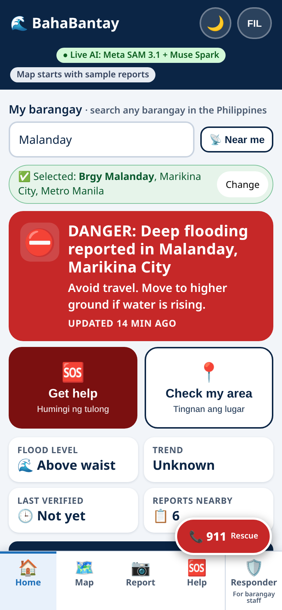 | 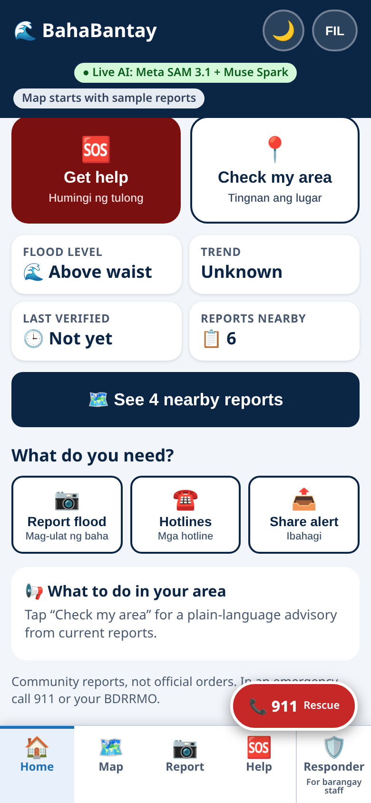 | 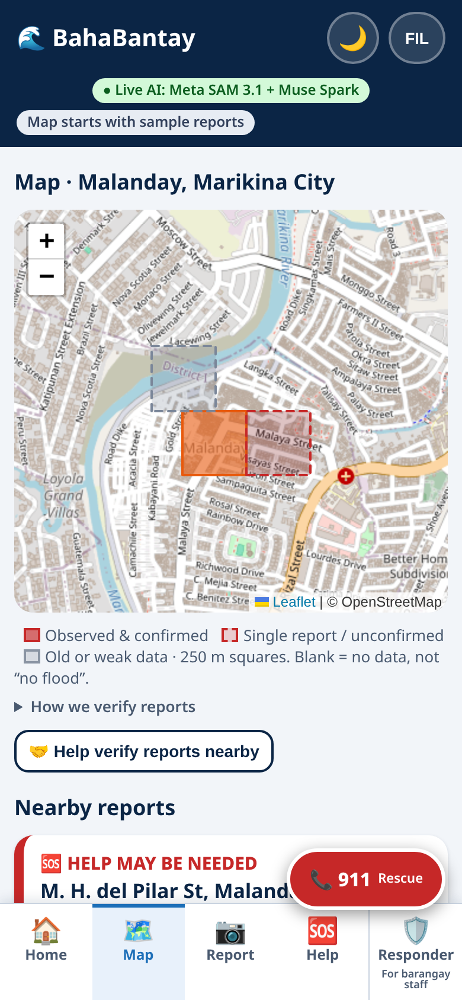 |
| **Square details** | **Nearby reports (plain wording)** | **Nationwide search** |
|  | 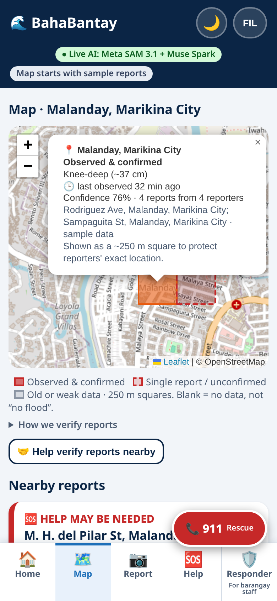 | 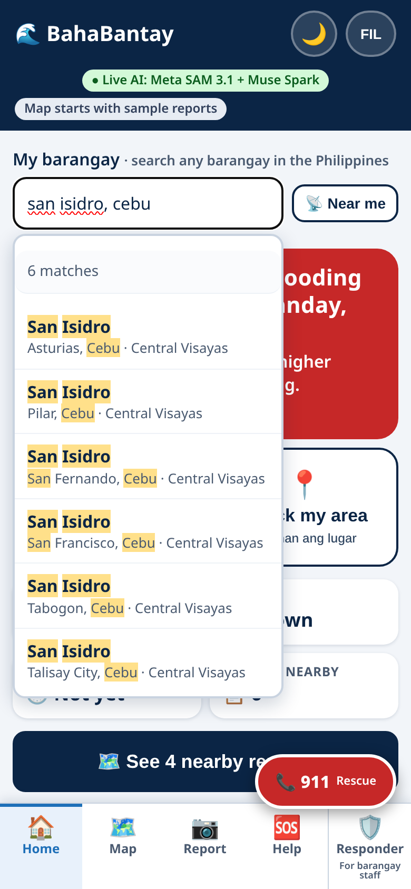 |
| **Outside coverage (Davao Oriental)** | **Report, step 3 of 3** | **AI suggests, you confirm** |
| 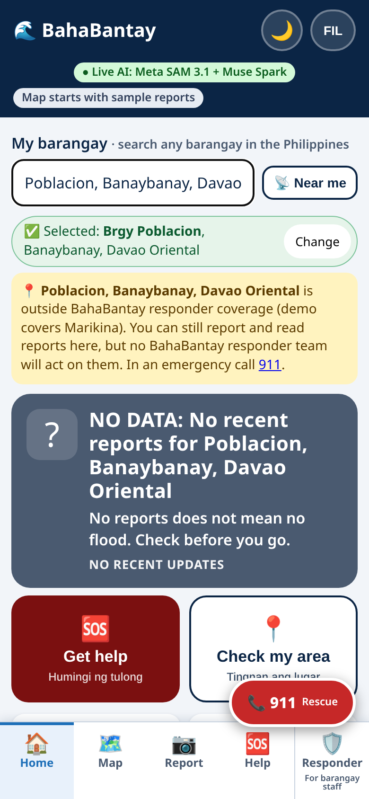 | 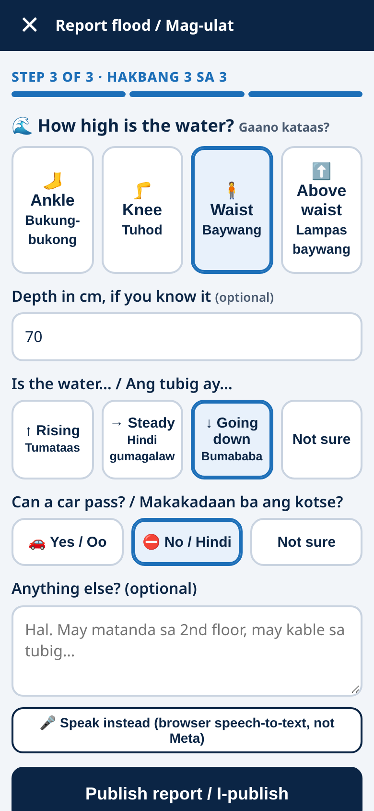 | 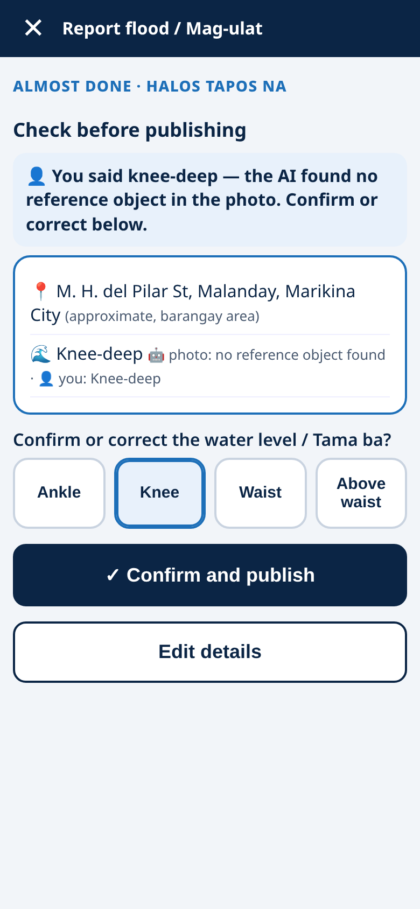 |
| **Help tab: 911, rescue, hotlines** | **Filipino** | **Dark theme** |
| 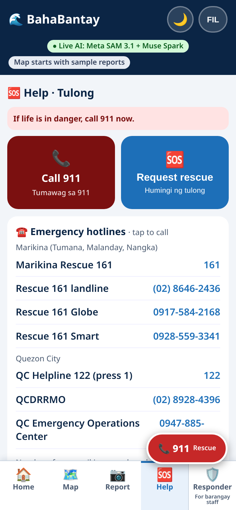 | 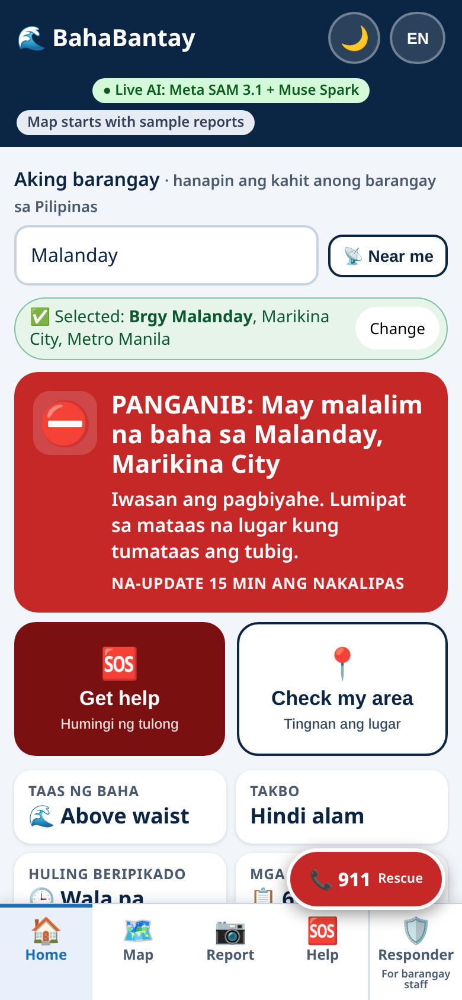 | 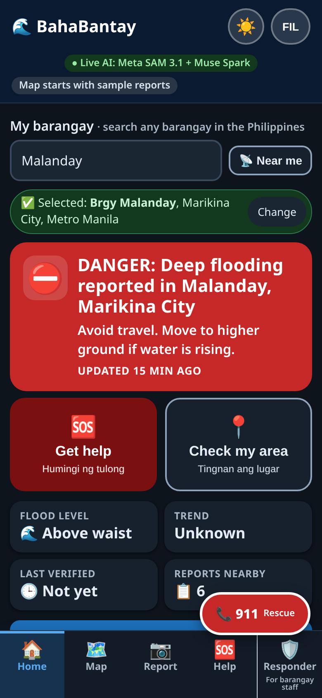 |

| Responder tab (for barangay staff): Action Grid | Evidence drawer |
|---|---|
| 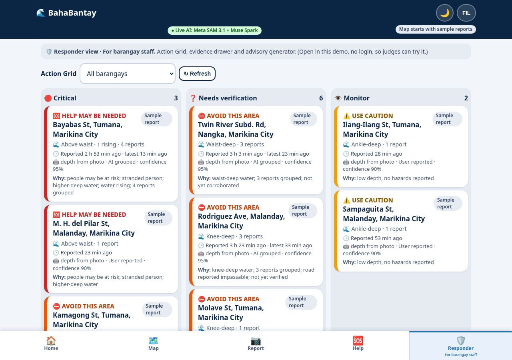 | 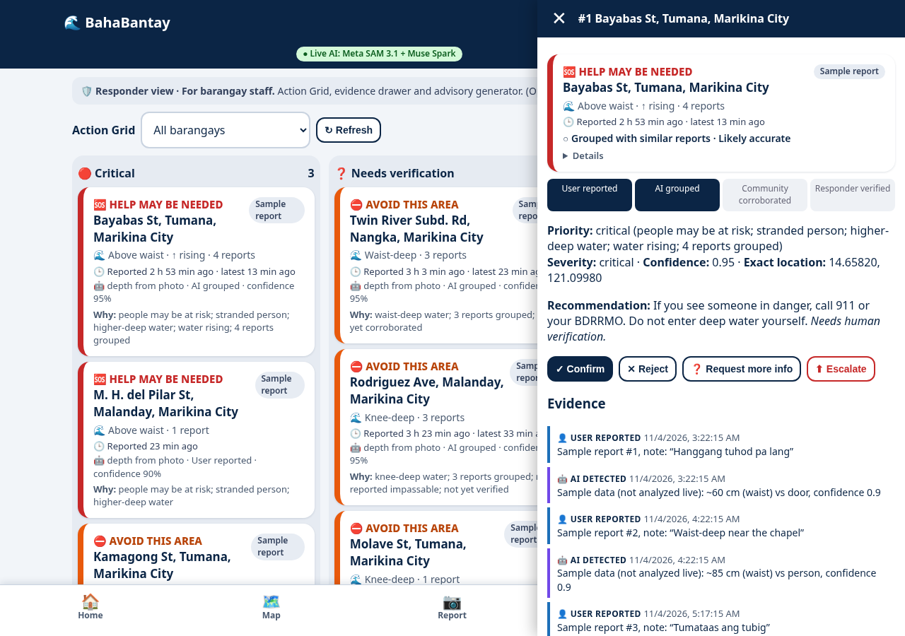 |
| **Advisory (EN / FIL / SMS)** | **Dark responder** |
| 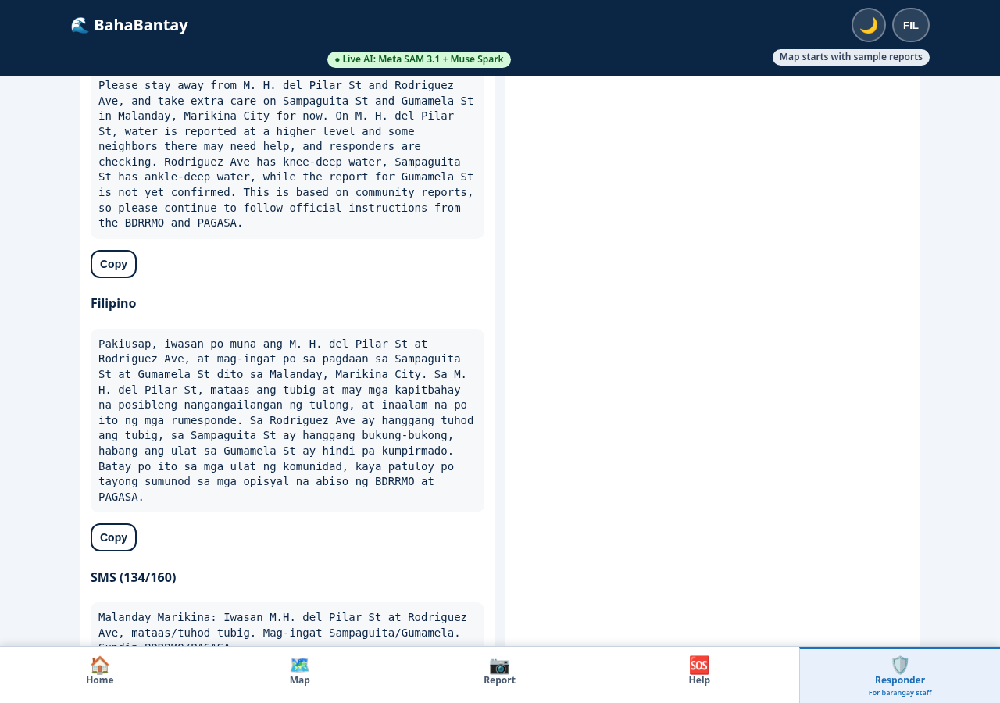 | 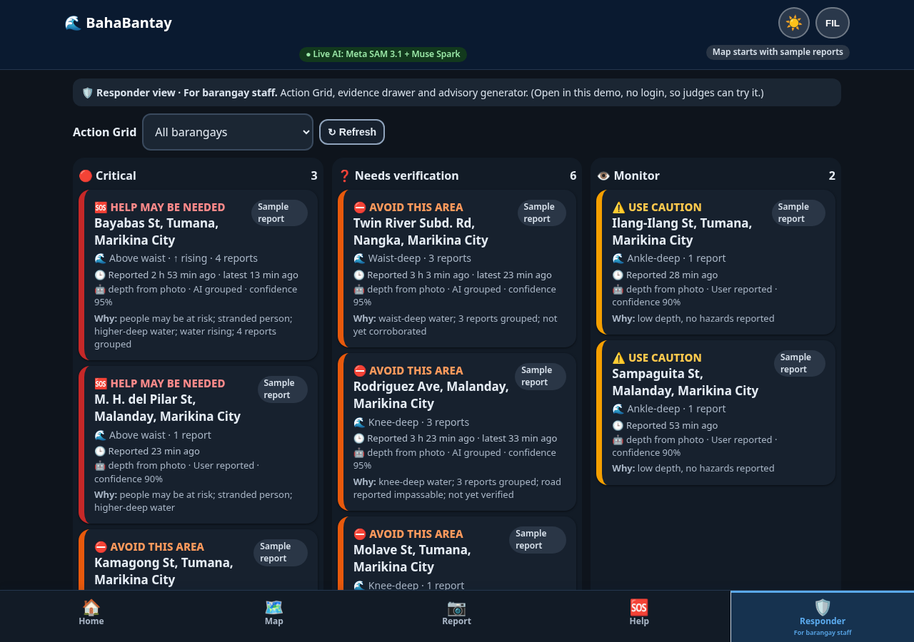 |

`09-ai-suggests-confirm.png` was taken on a local build (no live writes); all others are from the live demo.

## UX: alert → decision → action
- **Home opens on one question, "What should I do right now?"** A full-width alert for the selected barangay
  (e.g. *DANGER: Deep flooding reported in Malanday, Marikina City* · *Avoid travel. Move to higher ground if water is rising.*
  · *Updated 12 min ago*), then two big buttons: **Get help / Humingi ng tulong** and **Check my area / Tingnan ang lugar**.
- **Summary cards** (flood level, trend, last verified, reports nearby) and **See N nearby reports**; detailed cards live on the Map tab.
- **Bottom tabs:** Home · Map · Report · Help · **Responder (for barangay staff)**. The responder tab is open in the demo (no login)
  so judges can reach the Action Grid, evidence drawer and advisory generator.
- **Floating red 911 button** on every resident screen.
- **Four severity levels** (Safe / Watch / Danger / No data) with icons and words, not color alone; help requests get a dark-red
  **CALL FOR HELP** style.
- **Plain wording for residents** ("Verified by nearby reports", "Likely accurate"); the AI confidence % and method sit under
  **Details** and **How we verify reports**. The *Live AI: Meta SAM 3.1 + Muse Spark* banner stays in the header.
- **EN / FIL toggle** (remembered); urgent buttons always show both languages.
- **Every street is shown with barangay and city** (and province outside Metro Manila), e.g. *M. H. del Pilar St, Malanday,
  Marikina City*, since the same street name exists in other cities. Reports only group into one incident within the same
  barangay (PSGC code), so same-named streets in different cities never merge.
- Light and dark themes; mobile-first, fine on desktop.

## The loop
**Report → AI understands → Resident confirms → Alert → Help**

1. **Home tab**, mobile-first: pick any barangay in the Philippines (search, or **📡 Near me** from GPS); status alert
   *Safe / Watch / Danger / No data* with one plain action and freshness; *Get help* and *Check my area*; summary cards.
   **Map tab**: 250 m squares and nearby incident cards with "reported N min ago" and voting. **Help tab**: 911, rescue request, hotlines.
2. **Report flood**: photo → street/landmark (GPS, map tap, or barangay center marked approximate) → water level
   (Ankle/Knee/Waist/Above waist), shown as *Step 1 of 3*,, optional **depth in cm**, **trend** (rising / steady / going down / not sure), **can a car pass?**,
   optional note (browser speech-to-text available; that part is the browser, not Meta).
3. Progress screen while **SAM 3.1** segments the photo and **Muse Spark** reads the note.
4. **"AI suggests knee-deep — confirm or correct" card**: what the photo said vs. what the reporter entered, hazards found, with sources. The reporter
   can correct the level, then confirms. Nothing is published before that.
5. **Action card**: what we detected / what to do now / how to help, labeled *AI estimate, verify locally; not an official order*,
   plus **Share alert** (short Filipino-English text for Messenger/Facebook/SMS).
6. Neighbors tap **Still flooded / Already clear / Not sure**; a **No longer flooded** majority (≥2 votes) marks a flood *Safe to pass*.
   Help requests can't be cleared by votes.
7. **Get help** sends a high-priority request straight into the responder queue (exact location shown to responders only).
8. **Responder tab (for barangay staff), Action Grid**: incidents ranked *Critical / Needs verification / Monitor* with the reason;
   evidence drawer (reports, photos, AI detections, votes, responder actions, timestamps, confidence, recommendation);
   **Confirm / Reject / Request more info / Escalate**; advisory generator (English, Filipino, ≤160-char SMS); Q&A.
   "Avoid this area" incidents never sit in Monitor.

## Where is it flooded? Nationwide search + 250 m squares
- **All 42,010 barangays** (PSA PSGC, Q1 2026) are searchable server-side (`/api/barangays/search`, `/api/barangays/nearest`).
  Reports outside the demo's responder coverage (Marikina) are accepted and labeled **Outside responder coverage**.
  A barangay with no reports shows **No data**, never "Safe".
- **Search UX:** "Searching…" spinner while typing; every suggestion shows barangay + city, province and region, so the 374
  San Isidros are distinguishable; a match count ("20 of 374 matches, add a city or province to narrow"); a clear no-match hint;
  a "✅ Selected: Brgy, City, Province" chip with **Change**; keyboard navigation. Leading words match the barangay name and
  trailing words the place, so `san isidro, cebu` returns only San Isidro barangays in Cebu (a barangay *named* "Cebu"
  elsewhere is not mixed in).
- A barangay is a label, not a flood footprint. Each report is snapped to a **~250 m square** (`/api/cells`). Solid = observed &
  confirmed, dashed = single reporter, gray = old or weak. Blank = no data, not "no flood". Each square shows last observed time,
  weighted depth and confidence. The public map shows only squares; exact points are responder-only.
- **Decay and dedupe:** a report's weight halves every 60 min and expires after 6 h; several reports from the same device in the
  same square count as one reporter. A recent "car can't pass" turns the area into *Avoid this area*.
- Details: [`docs/affected-area.md`](docs/affected-area.md). Data and licenses: [`docs/data-sources.md`](docs/data-sources.md)
  (PSGC via the MIT-licensed `psgc` package; centroids from HDX/OCHA COD-AB, CC BY-IGO; map tiles © OpenStreetMap).

## Emergency hotlines
Tap-to-call card for Marikina (Rescue 161) and Quezon City (Helpline 122, QCDRRMO, EOC), numbers checked on marikina.gov.ph and
quezoncity.gov.ph on Nov 3, 2026. Elsewhere: 911.

## Where the Meta models are used
| Step | Model | Code |
|---|---|---|
| Segment water + reference objects (person, door, car tire, jeepney, curb) in each photo → depth in cm, level, confidence | **SAM 3.1** (`sam-3.1`, Responses API, one noun phrase per call) | `app/providers/meta.py` `MetaVision.segment`, `app/depth.py` |
| Read Filipino / English / Taglish notes into fixed fields: hazards, people at risk, water level, rising, short summary | **Muse Spark** (`muse-spark-1.3`) | `MetaReports.extract` |
| Triage plan: which agent tools to run (nearby reports, duplicate merge, people-at-risk, follow-up question) | Muse Spark | `MetaAgent.run`, `app/agent.py` |
| Barangay advisory in English + Filipino + SMS digest, from current incidents only | Muse Spark | `MetaReports.advisory` |
| Responder Q&A phrasing, grounded on a deterministic draft | Muse Spark | `MetaReports.answer`, `app/qa.py` |
| Bilingual situation report | Muse Spark | `MetaReports.situation_report` |

If a Meta call fails, the app falls back to a deterministic offline estimator (when `BAHABANTAY_META_FALLBACK=true`),
records it (`provider: "mock-fallback"` on the report, counter in `/api/health`) and shows it in the UI.

## Safety rules (run after the model, in `app/assess.py`)
The model proposes; fixed rules decide what people see:
- Never **Safe to pass** from a single photo/report: needs ≥2 reports or community "clear" votes.
- Never invent an exact location: location is only what the reporter gave; public views round to ~100 m; no pin = "approximate".
- Never escalate without a confidence value (`409` otherwise).
- Area **Danger** requires community/responder corroboration or people at risk.
- AI grouping alone is never "verified". Status ladder: *User reported → AI grouped → Community corroborated → Responder verified*.
- Live wires or strong current → *Avoid this area* even before depth is known. Can't-tell photos ask a follow-up question instead of guessing.
- Model JSON is clamped to the schema (unknown hazards/levels dropped).

## Architecture
```
static/index.html    Single page: resident Pulse view, report + help flows, responder Action Grid, Leaflet map
app/main.py          FastAPI routes (below)
app/assess.py        extraction schema, clustering into incidents, severity, action labels, ladder, priority, safety rules, advisory template
app/depth.py         segmentation → waterline vs reference-object height → depth cm, level, confidence (or "can't tell")
app/agent.py         agent tools: nearby reports, duplicate merge, people-at-risk, follow-up question; language detection
app/aggregate.py     per-street rollup: latest depth, least-squares trend (cm/h), passability
app/qa.py            grounded responder Q&A
app/cells.py         250 m grid cells, time decay, expiry, same-device dedupe, confidence
app/geo.py, app/geo/ PSGC barangay list (42,010) + centroids, search, nearest, coverage
app/db.py            SQLite (reports, votes, reviews)
app/providers/       base.py interfaces · meta.py (SAM 3.1 + Muse Spark, visible fallback) · mock.py (deterministic, offline)
scripts/             seed.py, eval_depth.py, eval_reports.py, make_eval_set.py, smoke_meta_sam.py
```
API: `GET /api/health` · `POST /api/reports` (multipart; `draft=true` for the confirm step) · `POST /api/reports/{id}/publish` ·
`POST /api/reports/{id}/answer` · `POST /api/help` · `GET /api/incidents?view=public|responder&barangay=` ·
`POST /api/incidents/{id}/vote` · `POST /api/incidents/{id}/review` · `GET /api/area/{brgy}` · `GET /api/advisory/{brgy}` ·
`GET /api/cells` · `GET /api/barangays/search?q=` · `GET /api/barangays/nearest?lat=&lng=` · `GET /api/barangays/resolve?label=` · `GET /api/summary/{brgy}` · `GET /api/sitrep/{brgy}` · `POST /api/ask` · `GET /api/reports`, `/api/barangays`.

## Run it
```bash
python3 -m venv .venv && .venv/bin/pip install -r requirements.txt
.venv/bin/python -m scripts.seed                 # sample reports (labeled "Sample report")
.venv/bin/uvicorn app.main:app --port 8765       # http://localhost:8765  (offline estimator by default)
.venv/bin/pytest -q                              # 66 tests
```
Live Meta models: put `META_API_KEY=...` and `BAHABANTAY_PROVIDER=meta` in a local `.env` (gitignored) or the environment.
Other env vars: `BAHABANTAY_META_FALLBACK` (default true), `BAHABANTAY_DB`, `BAHABANTAY_UPLOADS`. Also `BAHABANTAY_HALF_LIFE_MIN` (60), `BAHABANTAY_EXPIRE_H` (6), `BAHABANTAY_DEMO_CLOCK`. Deploy (Cloud Run): [`docs/deploy.md`](docs/deploy.md).

## Prototype evaluation (synthetic data only)
| Eval | Data | Result |
|---|---|---|
| Depth math (`scripts/eval_depth.py`) | 25 synthetic mask sets with known depths | MAE 5.3 cm, level accuracy 71%, can't-tell 16% |
| Report understanding (`scripts/eval_reports.py`), **Muse Spark** | 26 synthetic FIL/EN/Taglish text reports | water level 92%, people-at-risk 88%, hazards P/R 94%/94%, severity agreement 92%, critical recall 100%, ~5.7 s per report |
| Same, keyword rules (offline fallback) | same 26 | water level 96%, people-at-risk 100%, hazards P/R 100%/94%, severity 92% — **optimistic: the keyword list and the test set were written by the same team** |
| Incident grouping | same 26 | pairwise accuracy 100%, precision 100%, recall 92% |

These are prototype checks on data we wrote and labeled ourselves. They are not field accuracy. Details: `docs/eval/`.

## Honest limits
- **Advisory tone:** Muse Spark is prompted to write like a calm barangay officer: plain language, streets named, status labels
  paraphrased rather than copied, grounded only in the current incident facts (no invented numbers or places), plus a ≤160-char
  Taglish SMS. If the Meta call fails, the deterministic template advisory is used and the header says so.
- **Dark theme:** 🌙/☀️ toggle in the header. Defaults to the device's light/dark setting, remembers your choice, and is applied
  before the page paints (no white flash). Covers every screen including the map (OpenStreetMap tiles are darkened with a CSS
  filter; attribution kept). Status labels always carry text and icons, not just color.
- The advisory generator takes about 26–40 s on the live Meta models (a spinner shows while it works).
- Barangay centroids are approximate (84 have no polygon match and are flagged); they only label and center the map, never mark a flood.
- 250 m squares show where reports are, not the true flood boundary; there is no interpolation, elevation or drainage model yet.
- Responder coverage in the demo is Marikina only; hotlines are verified for Marikina and Quezon City only.
- No real flood photos with measured depths yet; depth accuracy on real photos is unmeasured.
- Sample reports are synthetic and use placeholder images.
- SQLite on one Cloud Run instance; submitted reports reset when the container restarts. No login: the responder view is open in the demo.
- Speech-to-text uses the browser's Web Speech API (not Meta) and only works in browsers that support it.
- Not an official warning system. Residents should follow BDRRMO, PAGASA and 911.
